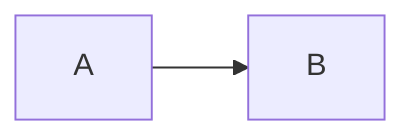

# malchut

A native Wayland app for writing slides in Markdown and presenting them.
It is written in Rust with GTK4, and renders with Cairo and Pango instead of a WebView.

- Live preview that updates as soon as you save the Markdown file
- Presenter view (current and next slide, notes, timer) kept in sync with the slide window
- Thumbnail overview for jumping to any slide
- Syntax highlighting, Mermaid diagrams, and flexible image placement
- Switchable themes
- Vector PDF export with selectable text

The syntax is inspired by [Marp](https://marp.app/), but it is not compatible with it.

## Build

You need Rust 1.95 or later and the GTK4 development libraries (gtk4, cairo, pango, gdk-pixbuf).

```sh
cargo build --release
```

The binary is written to `target/release/malchut`.

## Usage

```sh
malchut slides.md                      # open the preview
malchut slides.md --theme dark         # open with a specific theme
malchut export slides.md               # write slides.pdf
malchut export slides.md -o out.pdf    # choose the output path
malchut export slides.md --png-dir out # write one PNG per slide
```

`examples/demo.md` is a sample deck that uses every feature.

```sh
cargo run --release -- examples/demo.md
```

## Keys

| Action | Keys |
|---|---|
| Next slide | `→` `↓` `Space` `PageDown` `l` `j` |
| Previous slide | `←` `↑` `Backspace` `PageUp` `h` `k` |
| First / last slide | `Home` / `End` |
| Jump to a slide number | digits + `Enter` |
| Toggle the thumbnail overview | `g` |
| Start presenting | `F5` |
| Stop presenting / close the overview | `Esc` |
| Swap the slide and presenter screens | `s` |
| Toggle fullscreen | `f` / `F11` |
| Start / pause the timer | `t` |
| Reset the timer | `Shift+T` |
| Switch theme | `Shift+→` / `Shift+←` |
| Reload | `Ctrl+R` |
| Quit | `q` / `Ctrl+Q` |

In the thumbnail overview, move the selection with the arrow keys or `hjkl` and press `Enter` to jump.

When presenting with two monitors, the presenter view goes fullscreen on the monitor you started
from and the slides go fullscreen on the other one. With a single monitor, both open as regular
windows.

## Writing slides

````markdown
---
theme: default
size: 16:9
paginate: true
footer: Talk title
---
<!-- _class: lead -->

# Title

<!-- This is a speaker note -->

---

## Second slide

- A bullet
- [Go to slide 3](#3) / [Go to a heading](#code)


---

## Code

```rust {2} numbered
fn main() {
    println!("hello");
}
```


````

### Slides and settings

- Slides are separated by `---`, with a blank line before and after.
- The front matter at the top sets deck-wide options.
  - `theme`: theme name
  - `size`: `16:9` (1920×1080) or `4:3` (1440×1080)
  - `paginate`: whether to show page numbers
  - `header` / `footer`: text shown in the top and bottom margins
- A comment such as `<!-- class: lead -->` is a directive. It applies to that slide and every
  slide after it. Prefix the key with `_`, as in `_class`, to apply it to that slide only.
  The available directives are `class`, `paginate`, `header`, and `footer`.
- Any other comment becomes a speaker note.

### Code blocks

- Add a language name to get syntax highlighting.
- `{2,4-6}` highlights lines, and `numbered` shows line numbers.
- Lines that do not fit are not wrapped; the font is shrunk instead.
- Use `mermaid` as the language to render a diagram.

### Images

Put images in a paragraph of their own, and list options in the alt text.

| Syntax | Meaning |
|---|---|
| `w:400` `h:300` `w:50%` | Size. With only one of them, the aspect ratio is kept |
| `bg` / `bg contain` | Use as the background (fills the area with `cover` by default) |
| `bg left:40%` / `bg right:40%` | Put the background on one side and flow the text in the rest |
| `side:left` / `side:right` | Place beside the text (set the width with `w:`, 40% by default) |
| `at:70%,20%` `anchor:center` | Place at an absolute position |
| `align:left\|center\|right` | Horizontal position in the text flow (centered by default) |
| `crop:x,y,w,h` | Crop the source image |
| `round:16` `shadow` `opacity:0.6` | Rounded corners, shadow, opacity |
| `` | Caption |

Several images in one paragraph are laid out side by side.

### Links

| Syntax | Behavior |
|---|---|
| `[text](#3)` | Jump to slide 3 |
| `[text](#heading)` | Jump to the slide that has that heading |
| `[text](https://...)` | Open in the browser |

Links are also embedded in the exported PDF.

## Themes

The built-in themes are `default` and `dark`. Put your own theme in either of these locations:

- `<directory of the Markdown file>/themes/<name>/theme.toml`
- `~/.config/malchut/themes/<name>/theme.toml`

In `theme.toml`, write only the values you want to change from the default theme.

```toml
[palette]
background = "#fdf6e3"
foreground = "#073642"
accent = "#268bd2"

[fonts]
body = "IBM Plex Sans JP"

[code]
theme = "SolarizedLight"

# Overrides for slides marked with <!-- class: lead -->
[class.lead.heading]
sizes = [140, 90, 64, 52, 44, 40]
```

Every available key and its default value is listed in
[`crates/malchut-core/themes/default.toml`](crates/malchut-core/themes/default.toml).

## Limitations

- Images mixed into a line of text and images given by URL are not displayed.
- Inline HTML and math are not supported.
- PDF export is available from the command line only.
- Syntax highlighting color schemes are limited to the bundled ones.

## Design

See [`docs/design.md`](docs/design.md) (in Japanese) for the architecture and the full specification.
