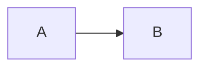
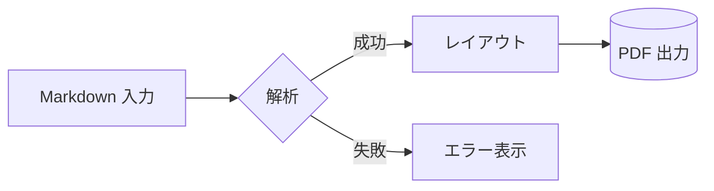
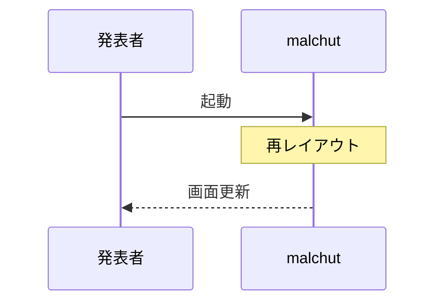

<!-- _class: lead -->
<!-- _paginate: false -->

# malchut

Markdown からスライドを作る

<!-- 最初の挨拶。自己紹介は30秒で。 -->

---

## 目次

- [コードハイライト](#コードハイライト) (見出しへのリンク)
- [8 枚目のスライド](#8) (スライド番号へのリンク)
- [外部リンク](https://example.com) (ブラウザで開く)

| 項目 | リンク |
|------|--------|
| 表の中 | [画像](#画像) |

---

## テキストとリスト

本文の段落です。**強調**、*斜体*、~~取り消し~~、`inline code`、
[リンク](https://example.com) が使えます。日本語の改行は
空白なしでつながります。English lines
are joined with a space.

- 箇条書きの項目
- 入れ子のリスト
  - 子の項目 A
  - 子の項目 B
- [x] 完了したタスク
- [ ] 未完了のタスク

1. 番号付き
2. リスト

---

## コードハイライト

```rust {2,4-5} numbered
fn main() {
    let deck = parse("# hello");
    for slide in &deck.slides {
        let list = layout(slide);
        paint(&cr, &list);
    }
}
```

```toml
[palette]
background = "#ffffff"
```

---

## 表と引用

| 項目 | 説明 | 数値 |
|:-----|:----:|-----:|
| parse | Markdown を解釈 | 1 |
| layout | 配置を計算 | 20 |
| paint | Cairo に描画 | 300 |

> 引用文です。
> 2行目も続きます。

<!-- 表の数値は仮のもの -->

---
<!-- class: invert -->

## 反転クラス

```ruby
def hello(name) = puts "hello, #{name}"
```

- 以降のスライドにも適用される

---

## あふれるコード

```python
print("this is a very long line that should shrink the font size to fit within the slide width, hopefully without overflow")
```



---
<!-- class: -->

## Mermaid



---
<!-- class: invert -->

## シーケンス図



---

## 図のエラー

```mermaid
graph LR
  A --> 
  --> B[
```

---
<!-- class: -->

## 画像


---

## 画像を並べる

  

---

## 背景を片側に


- 背景画像は右側 40% を使う
- 本文は残りの領域に流れる

---

## 片側に画像


- 画像は余白の内側に置かれる
- 本文は残りの幅に流れる


---
<!-- _class: lead invert -->


# 全面背景

---

## 読めない画像

 
